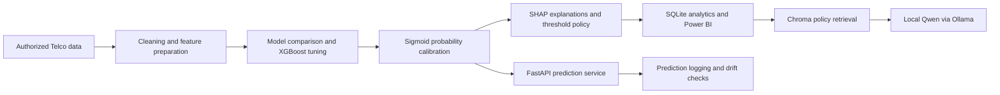

# Customer Churn & Retention Analytics with RAG

An end-to-end telecom churn analytics project that combines calibrated classification, customer-level explanations, capacity-aware retention thresholds, a SQLite serving layer, and policy-grounded recommendations. The repository keeps the modeling and serving code, synthetic retention policies, and aggregate evaluation summaries. Customer-level source data, generated customer records, and the fitted model artifact are not included.

## Problem

Retention teams need to identify customers at risk of leaving, understand the model's signals, and prioritize limited outreach capacity. A churn probability alone does not define an action, so this project separates analytical risk scoring from campaign and high-priority thresholds.

## Workflow



## Data

The experiments used a 7,043-customer Telco churn table. It contains customer-level demographic, billing, service, and geographic fields. The source files are excluded from this repository because they contain row-level customer information, and the local project files did not record sufficient dataset source and redistribution-license information to republish them.

To reproduce the training notebooks, obtain an authorized copy of the dataset, verify its license and attribution, and place it at `data/raw/Telco_customer_churn.csv`. The early notebooks write prepared tables under `data/processed/`; those generated files are also excluded.

The retention policy documents in `rag/knowledge_base/retention_policies.csv` are explicitly synthetic demonstration content, not real company policy.

## Feature preparation and models

- Removed identifier and outcome-leakage fields from the predictive feature set, including customer ID, churn label/score, and post-churn reason.
- Prepared 19 predictive features from service, contract, tenure, and billing attributes.
- Compared Logistic Regression, Random Forest, and XGBoost; tuned XGBoost and applied sigmoid calibration to its churn probabilities.
- Used training out-of-fold predictions to set an analytical threshold and separate campaign-capacity and high-risk thresholds. The holdout set was reserved for evaluation.
- Used permutation importance and XGBoost TreeSHAP for global and customer-level explanations.
- Used SQLite tables/views for customer risk, explanation, threshold, and campaign analysis. A notebook demonstrates a Power BI reporting layer.
- Retrieved applicable synthetic retention policies with Chroma and generated cited recommendations with Qwen through local Ollama. Citation-ID checking is a limited grounding check, not proof of factual faithfulness.

## Results

| Evaluation view | Result |
|---|---:|
| XGBoost tuning cross-validation mean PR-AUC | 0.6939 ± 0.0176 |
| XGBoost tuning cross-validation mean ROC-AUC | 0.8649 |
| Calibrated holdout ROC-AUC (1,409 rows) | 0.8558 |
| Calibrated holdout PR-AUC | 0.6710 |
| Calibrated holdout Brier loss | 0.1338 |
| Calibrated holdout log loss | 0.4137 |

These figures come from different evaluation stages: the first two are tuning cross-validation summaries, while the latter four describe final calibrated probabilities on the holdout set. They should not be compared as if they were the same split. At the recall-focused analytical threshold of 0.09, the project report records 93.58% recall and F2 of 0.7619; that threshold flags about 57% of customers and is not the campaign-capacity threshold.

## Run

Use Python 3.13 or a compatible version. Install the serving and test dependencies. Before starting the API or running its integration tests, obtain an authorized dataset copy and run the training workflow to create `models/final_tuned_churn_model.joblib`; the model is excluded from Git because its training-data redistribution/privacy review is incomplete:

```bash
python -m venv .venv
# Windows PowerShell
.venv\Scripts\Activate.ps1
python -m pip install -r requirements-dev.txt
python -m pytest -q
```

After generating the approved model artifact, start the API using its joblib fallback:

```bash
python -m uvicorn api.main:app --host 127.0.0.1 --port 8000
```

Open `http://127.0.0.1:8000/docs` for the API schema. The included test profile is synthetic and is only for contract checks.

The modeling workflow is organized as notebooks under `notebooks/`. Run them in numerical order after acquiring an authorized dataset copy. Notebooks have been cleared of saved outputs so customer rows and local machine output are not embedded in the repository. The RAG workflow also requires a local Ollama installation and the `qwen3:4b-instruct` model; model weights are not included.

After generating the approved model artifact, the Docker image packages the API and fallback model:

```bash
docker build -t customer-churn-rag .
docker run --rm -p 8000:8000 customer-churn-rag
```

The API reports `joblib_fallback` when no MLflow registry database is available. The local MLflow database, artifacts, and DVC cache/remote are not included. Training and data-versioning workflows require locally configured, authorized data and storage.

## Repository structure

```text
api/                         FastAPI schemas and inference service
monitoring/                   Input and prediction drift checks
notebooks/                    Data, modeling, explainability, SQL, RAG, and MLOps workflow
models/                       Small fallback estimator and business threshold policy
rag/knowledge_base/           Synthetic retention policy examples
reports/metrics/              Aggregate tuning and calibrated holdout metrics
scripts/                      Clearly labeled simulated-monitoring traffic generator
src/                          MLflow server launcher
tests/                        API and validation tests using a synthetic profile
```

## Reproducibility and design decisions

- The final model's feature list excludes customer identifiers and known leakage columns.
- Analytical, campaign, and high-risk thresholds answer different operational questions and are stored separately.
- The API validates inputs and records traffic labels so simulated validation is distinguishable from production traffic.
- The locally generated 1.6 MB joblib fallback is ignored by Git until the training-data privacy and redistribution review is complete. Databases, raw data, customer-level predictions, local logs, DVC state, and Power BI files are excluded.
- Notebook outputs are cleared. Aggregate results are retained in `reports/metrics/`.

## Limitations

- The evaluation is on one static Telco dataset and does not establish performance on another provider or later time period.
- The dataset source/license must be checked by anyone obtaining data for reproduction.
- Drift checks were demonstrated with explicitly simulated requests generated from project records; they are not evidence of production drift.
- RAG citation-ID matching does not establish that every generated statement is factually correct or that a recommended action improves retention.
- No production traffic, deployment, or business lift is claimed.
- The local MLflow registry and DVC storage are intentionally not published; configure separate storage before using those workflows.

## Technologies

Python, pandas, NumPy, scikit-learn, XGBoost, SHAP, Chroma, Qwen/Ollama, SQLite, FastAPI, Pydantic, MLflow, DVC, Docker, pytest, Jupyter, Power BI.
